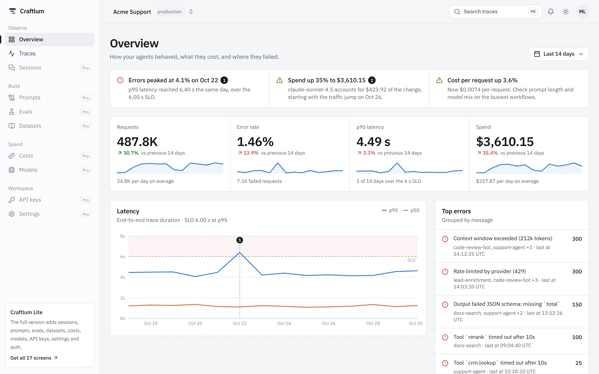

# Craftlum Lite: free LLM observability dashboard for Next.js

A free, open-source dashboard template for LLM apps and AI agents. See what your agents did, how long
each step took, and where they failed. Built with Next.js 16, React 19, Tailwind CSS v4 and shadcn/ui
conventions.

**[Live demo](https://demo.craftlum.com)** · **[Full version](https://craftlum.com)**



## What's inside

| Screen | What it shows |
| --- | --- |
| Overview | A briefing of what changed, KPIs with sparklines, latency against the SLO with pinned annotations, top errors, latest run waterfall, recent traces |
| Traces | Search, status, workflow and model filters kept in the URL, sorting, paging, latency histogram with p50 and p95 |
| Trace detail | Selectable span waterfall, span inspector with input and output, failure banner |

Plus the app shell (sidebar, top bar, project switcher, light and dark themes), the design tokens and
the UI primitives the screens are built from.

## Getting started

```bash
pnpm install
pnpm dev          # http://localhost:3000
pnpm build        # production build
pnpm build:static # static site in out/, for Cloudflare, S3 or any static host
```

## Use your own data

Every screen reads from `src/lib/mock`: `getTraces`, `buildOverview` and the workflow definitions in
`workflows.ts`. All demo data is seeded, so server and client render the same numbers. Replace those
functions with calls to your tracing backend (Langfuse, LangSmith, OpenTelemetry, Helicone or your own
database). Components only depend on the exported types.

## Design system

Chrome is ink, color is data. Surfaces stay neutral and hue is reserved for series, span types and
status. Tokens live in `src/app/globals.css` with shadcn/ui names, so `npx shadcn add <component>`
picks up the theme. Light and dark mode are tuned separately, and chart colors are a fixed,
colorblind-checked order.

## Craftlum full version

Lite has 3 screens. [Craftlum](https://craftlum.com) has 17, all built on the same design system:

- **Sessions:** conversations stitched from traces, every reply linked to its run
- **Prompts:** version registry with diffs, score changes and a promote flow
- **Evals:** runs against a baseline, fixed and broken cases, judge verdicts
- **Datasets:** eval cases, failures worth adding, staleness against prompts
- **Costs:** cycle burn with forecast and budget, spend by workflow and customer, alert rules
- **Models:** cost against speed per model, error rates, which workflows use each
- **API keys, settings, login and sign-up**

One-time payment, from $39. [See pricing](https://craftlum.com/pricing/).

## License

MIT for this Lite version. The full version is sold under a commercial license.
